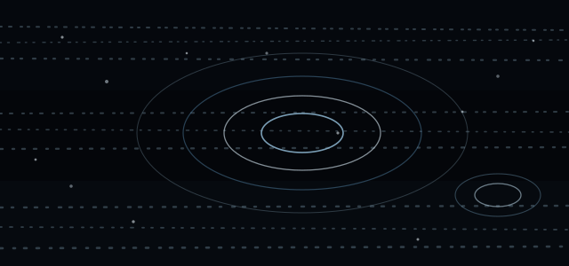

# ASCII 水纹壁纸（DSH 桌面背景主题插件）

在 DeepSeek Harness（DSH）桌面壳的最底层渲染一个全屏 ASCII 水面，作为「桌面壁纸」：水纹流动、锦鲤巡游、时间以字符漂在水面上。算法移植自参考页 `ASCII 水纹 · 锦鲤` 的流场（域扭曲涡流）、Ripple 涟漪类、Particle 悬浮粒子、三层 depthBands 分层，以及鱼体骨骼链光栅化与水面时钟的形变场，并适配 DSH 的插件环境。



## 特性

**水面**

- 黑色底色 + 由暗到亮的 ASCII 字符水纹，含水流流动与涡流扭曲动画。
- 三层纵深（远景 / 中景 / 近景），字符大小、透明度、流速随深度区分。
- 鼠标移动 → 轨迹涟漪；点击 → 冲击涟漪；光标静止 → 呼吸式小涟漪。
- 少量缓慢漂浮的颗粒字符。
- 涟漪只做环带局部计算（非全屏遍历），自动处理 DPR 与超宽屏字符缩放。
- 三角函数与高次幂走 4096 / 1024 项查表，水纹场从约 9 ms/帧降到 1.5 ms/帧。

**锦鲤**

- 8 条（可调）锦鲤，17 关节骨骼链 + 逐节限角，摆尾是叠加在物理链上的行波。
- 体侧按圆柱伪光照算明暗，花斑绑在体表坐标上随鱼游动；尾鳍分叉、半透明、带放射纹；胸鳍腹鳍随速度开合划水。
- 鱼落在独立字符网格上（比水纹更细），并生成一圈遮罩让水纹让位、外围一圈压暗，鱼才看得清。
- 群体行为：巡游 / 缓滑 / 停歇 / 冲刺四种「心情」加权切换，聚拢 + 对齐 + 个体分离；靠近光标会躲，点击水面会炸开。
- 尾鳍在水面拖出小涟漪，游得越快越密。

**水面时钟**

- 时间（时:分 或 时:分:秒）先画进离屏画布做 4× 超采样，再转成每格覆盖率，用弹簧 + 阻尼 + 邻格耦合的形变场推动，字会像浮在水上一样被涟漪和鱼推开。
- 数字变化时旧字形平滑过渡到新字形，整块字缓慢漂移并有浮雕光照与一道扫过的光。
- 出现 / 消失是逐格错峰的「浮出水面 / 沉下去」。

**投饵 / 引鱼**

- 长按水面 320 ms 撒饵，鱼群会把目标点换成饵游过来吃，饵被吃或 7.5 s 后化掉。
- 长按后移动光标则从「投饵」切成「引鱼」，鱼群分轨围着光标绕圈。

## 交互

| 操作 | 效果 |
| --- | --- |
| 移动光标 | 拖出涟漪，出涟漪带；水面时钟的字被轻轻拨开 |
| 单击 | 冲击涟漪 + 鱼群惊散 + 时间文字被径向撞开 |
| 长按 320 ms | 投饵（最多 3 颗） |
| 长按后拖动 | 引鱼，鱼群绕光标游 |
| 光标静止 | 呼吸式小涟漪 |

> 参考页用 `T` / `S` 键切时钟模式，装进桌面壳后会抢走用户打字，这里改为配置项 `clockMode`。摇一摇依赖 `devicemotion`，桌面拿不到，未移植。

## 安装

**方式一：从 GitHub 克隆后本地安装**

```
git clone https://github.com/cjajk/dsh-ascii-water-wallpaper.git
```

然后在 DSH 的 **Plugins（插件）** 面板选择 **Add plugin（添加插件）**，指向克隆下来的目录；或在 Agent 中运行：

```
plugin_manager install_bundle <克隆目录的绝对路径>
```

**方式二：直接从本地目录安装**

把本目录（含 `package.json`、`cordis.patch.yml`）指向 Plugins 面板 Add plugin，或使用上面的 `install_bundle` 命令。

安装后在插件行或设置中开启即可，背景立即出现在所有窗口之下。

> 仓库按 bundle 结构发布，无需 `npm install`：运行期依赖由 DSH 宿主提供（`@deepseek-ai/schemastery` 等），`node_modules` 不入库。

## 可配置项

全部参数通过插件设置面板实时调节（volatile，即时生效）：

| 参数 | 说明 |
| --- | --- |
| `bgColor` | 背景底色 |
| `charColor` | 字符颜色（水纹、鱼、时间、饵粒共用） |
| `fontSize` | 基础字符字号（px） |
| `waterSpeed` | 水流流动速度 |
| `rippleRadius` | 涟漪扩散半径（px） |
| `clickRippleScale` | 点击涟漪强度倍数 |
| `maxRipples` | 最大同时涟漪数 |
| `trailGap` | 轨迹涟漪间距（px） |
| `trailScale` | 轨迹涟漪缩放 |
| `particleCount` | 悬浮颗粒数量 |
| `swimFish` | 锦鲤群开关 |
| `fishCount` | 锦鲤数量（0–24，0 等同关闭） |
| `clockMode` | 水面时钟：0=关闭，1=时:分，2=时:分:秒 |
| `baitEnabled` | 长按投饵开关 |
| `leadEnabled` | 按住拖动引鱼开关 |
| `uiOpacity` | 所有界面面板/任务框的不透明度（1=不透明，0.7 左右开始明显透出背景，0=完全透明） |

## 半透明是怎么做的

v1.1 起不再依赖主题服务的 `overrideTokens`（该接口不生效时界面会一点也不透，背景被完全盖住），改成两路同时生效：

1. **改写 surface token**：把 `--dsw-alias-bg-base`、`--dsw-alias-bg-layer-1/2`、`--dsw-alias-bg-overlay`、`--dsw-specific-sidebar-fill` 直接写成 `rgba(主题底色, uiOpacity) !important`，并把 `html`、`body` 的底色置为透明。采样前会临时摘掉自己的覆盖，所以主题明暗切换后读到的是新主题的底色（v1.2）。
2. **面板扫描**：遍历已渲染的元素，凡是「不透明背景 + 无渐变/图片背景 + 面积 ≥ 10000 px²」的，把同一种颜色就地换成同色半透明（原始色记在内存里，卸载时还原）。挂载新面板时由 `MutationObserver` 增量补扫，所以新开的任务框也会跟着变透。小号按钮、输入框不接管，保留它们本来的 hover / 选中反馈（v1.2）。

**为什么不碰 `#root`（v1.2）**：给 `#root` 挂 `z-index` 或 `backdrop-filter` 会生成堆叠上下文 / 包含块，菜单、tooltip、toast、窗口标题栏按钮这类 `position: fixed` 浮层可能被锁在里面或被裁掉。v1.2 改成把画布 `z-index: -1` 沉到所有内容之下，`#root` 完全不动，效果一样但没有副作用。这个坑是参考 `TQSY114514/dsh-ui-appearance` 的实现笔记后修的。

## 文件结构

- `index.js` —— Host 半，声明 `Config` 配置 schema。
- `client.js` —— 浏览器半，画布渲染引擎（水纹 / 锦鲤 / 水面时钟 / 投饵引鱼）+ 半透明化 + 配置订阅。
- `cordis.patch.yml` —— 插件注册行（`id: ascii-water` 即配置命名空间）。
- `locale/`、`icon.svg`、`docs/` —— 插件元信息与详情页素材。

## 性能与已知取舍

- 水纹场逐格逐帧重算，但三角函数与 `sin^8` / `sin^11` 全部查表；1920×1080 下约 2.1 万格，纯计算约 1.5 ms/帧。
- 鱼体按包围盒逐格 × 17 条脊椎线段求最近点，8 条鱼约 3 万次距离运算/帧；画不动时可调小 `fishCount`。
- 水纹场不能降采样插值：`sin^8` 的脊线宽度不足一个采样步，插值会直接把水纹抹平（实测过），所以只能在三角函数本身省。
- 字符抖动使用逐帧随机，视觉上有轻微噪点。

## 许可

MIT
